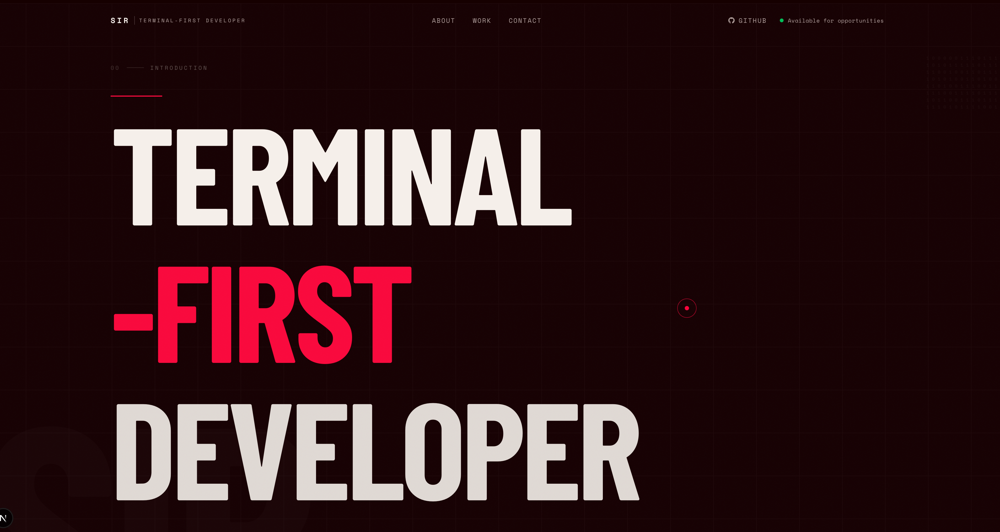

# Sojibul Islam Rana — Portfolio

> Terminal-First Developer · React · Next.js · TypeScript · Node.js · Bangladesh

A visually distinctive, editorial-driven personal portfolio website inspired by [wodniack.dev](https://wodniack.dev/). Built with bold typography, GSAP scroll animations, and a vivid red-on-black design language.

---

## Tech Stack

| Concern | Choice |
|---|---|
| Framework | Next.js 16 (App Router) |
| Language | TypeScript (strict) |
| Styling | Tailwind CSS + custom CSS |
| Animation | GSAP + ScrollTrigger |
| Fonts | Barlow Condensed · Space Grotesk · Space Mono |

---

## Features

- **GSAP entrance animations** — staggered headline reveal, scroll-triggered section fades
- **Custom lerp cursor** — ring + dot with hover state, disabled on touch devices
- **Immersive project rows** — hover preview compositions, no broken image placeholders
- **Typographic skills grid** — ghost category labels, strong/learning distinction, scrolling ticker
- **Oversized CTA section** — word-by-word scroll reveal
- **Responsive** — intentional mobile layout, hamburger nav overlay
- **Reduced-motion safe** — all GSAP animations respect `prefers-reduced-motion`
- **Full metadata** — OG tags, Twitter card, SVG favicon

---

## Project Structure

```
├── app/
│   ├── layout.tsx        # Root layout, fonts, metadata
│   ├── page.tsx          # Page composition
│   └── globals.css       # Design tokens + base styles
├── components/
│   ├── sections/         # NavBar, Hero, About, Work, Skills, Contact, Footer
│   └── ui/               # CustomCursor, MagneticButton, SectionLabel, BackToTop
├── data/
│   ├── projects.ts       # Project content — edit here to update work section
│   ├── skills.ts         # Skills grouped by category
│   └── navigation.ts     # Nav links, social links, site config
└── public/
    ├── cover/cover.png   # Cover image
    ├── favicon.svg       # SIR monogram favicon
    └── og-image.svg      # Open Graph image
```

---

## Getting Started

```bash
# Install dependencies
npm install

# Start dev server
npm run dev

# Production build
npm run build

# Type check
npm run type-check

# Lint
npm run lint
```

Open [http://localhost:3000](http://localhost:3000) in your browser.

---

## Customisation

All content lives in `data/` — no hunting through components:

- **Site identity, email, socials** → `data/navigation.ts` → `siteConfig`
- **Projects** → `data/projects.ts` — add `demoUrl` when a live link is available
- **Skills** → `data/skills.ts` — change `level` from `"learning"` to `"strong"` as you grow
- **Colors** → `app/globals.css` → `:root` CSS variables

---

## Design Tokens

```css
--color-red:   #F40C3F   /* Primary brand */
--color-black: #160000   /* Near-black background */
--color-white: #F7F2ED   /* Warm white text */
--color-muted: #B9AAA7   /* Secondary text, metadata */
```

---

## License

MIT — built for personal use. Inspired by [Antoine Wodniack's portfolio](https://wodniack.dev/) design direction; all content, copy, and implementation is original.

---

<p align="center">
  <a href="mailto:sojibulislamrana.dev@gmail.com">Email</a> ·
  <a href="https://github.com/radiumSodium">GitHub</a> ·
  <a href="https://www.linkedin.com/in/sojibul-islam-rana">LinkedIn</a>
</p>
